# UI

How Cronk's web client looks and behaves. Read this before changing anything in the web client. Vocabulary follows `CONTEXT.md`. The UI holds no rules (`docs/testing.md`), so everything here is about presentation.

This direction comes from the old Cronk (`CronkCorp/Cronk`, its `docs/ui.md`), adapted to this rewrite. The screenshots in `docs/ui/` are of the web client itself, taken in a window 1280px wide (the phone's 390px) and kept current as [Changing this document](#changing-this-document) says, except the token sheets (`tokens-light.png`, `tokens-dark.png`), which are the old Cronk's prototype and still show its four Status categories. Where a screenshot and this text differ, the text wins.

The web client follows this file since the styling pass at the end of milestone 2 (`docs/roadmap.md`). The tokens live in `web/src/styles/tokens.css`, the shared components in `web/src/ui/`, the frame in `web/src/frame.tsx`, and each screen's layout in `web/src/styles/screens.css`. New screens build on them.

## Principles

- **What waits on the User comes first.** Questions before reviews, unread before read. Counts in the navigation say how much is waiting.
- **Agents and Users always look different.** A User's avatar is round and neutral. An Agent's is square and violet (`--agent`), and its name is violet wherever it appears. Cronk itself is plain muted text with a neutral round "C" avatar.
- **One chronology per thing.** A Ticket has one timeline holding its Comments, Reports, Runs and Changes. There is no separate history list.
- **Kinds are labelled, not just coloured.** Every timeline entry and Inbox item carries a small uppercase kind label (`QUESTION`, `REPORT`, `UNVERIFIED`). Colour backs the label up and never replaces it.
- **Live, in place.** Open views update without a reload and without moving what the User is reading (see [Live updates](#live-updates)).
- **Product words only.** Labels use `CONTEXT.md` terms ("Delegate", "Retry", "Accept", "Reopen"), never API words ("PATCH", "statusId").

## Layout and navigation


- **Frame:** a 232px left sidebar and a main column. The main column's content takes its whole width beside the sidebar, with 24px vertical and 16px horizontal padding, on every screen: there is no overall cap, so a wide window shows more of the board, a list or a split view. A page that needs a narrower measure sets its own, as settings pages do (760px of sections, 964px with their section list) and a Document's or Term's body does (720px).
- **Hiding the sidebar:** a button at the top of the sidebar, "Hide sidebar", hides it, and the main column widens into the window. Every page's content widens with it. While it is hidden, a "Show sidebar" button at the top left of the main column brings it back, and `Ctrl+\` (`⌘\` on macOS) toggles it either way, except while typing in a field or with a dialog open. Whichever button was used hands focus to the other. The choice is kept in the browser (`localStorage`), like the theme, so it stays hidden across reloads and pages until the User shows it again. Below 760px neither button shows and the shortcut does nothing: the strip is already small.
- **Sidebar, top to bottom:**
  - The Workspace name and mark, which opens a menu to switch Workspace or start a New Workspace, with the Hide sidebar button beside it.
  - The search box, which opens the Workspace's search results on Enter. Below 760px it takes a line of its own under the strip's links.
  - Inbox, with the number of waiting items as a red count.
  - Documents, Terms, Decisions and Artifacts (the Workspace's, or the current Project's).
  - **Projects**, each listed by key and name.
  - **Workspace**: Agents and Runners, plus Members, GitHub and Settings for Admins. Runners shows even without a Workspace, since a User's Runners belong to none.
  - The signed-in User, by their display name (else their email or GitHub login), marked "Admin" for an Admin, which opens a menu: Account settings and Sign out.
- **Active item:** `--accent-soft` background with `--accent` text. There is exactly one active item; a Ticket or Document marks its Project or Documents. A page the sidebar doesn't lead to, such as the Workspace's home, Account settings, New Workspace or a page that isn't there, marks none.
- **Below 760px** the sidebar becomes a wrapping strip with the main links, and Projects, Workspace and the User move into a menu. Two-pane screens stack.
- **Page head:** breadcrumbs (13px, muted, with `--accent` links), then a row holding the `h1`, the view switcher and the actions. A Decision's number and status sit on a line of their own between the breadcrumbs and the title, and a Document's, Term's or Decision's Version, who saved it and when on a muted line under it. The primary action comes last. Destructive actions such as Remove go in a "…" menu, never next to the primary action. Reject on a proposed Decision is not one, since nothing is lost: it sits beside Accept, though it still asks first.
- **Addresses** are readable (ADR 0008), all built in `web/src/addresses.ts`. Every page of a Workspace is under its Workspace slug:
  - `/<workspace>`, the Workspace's home, and its own pages: `/inbox`, `/search?q=…`, `/documents`, `/glossary`, `/decisions`, `/artifacts`, `/agents` and `/agents/<agent id>`, `/members` and `/settings` (its name and lost-Run threshold).
  - A Project: `/<workspace>/projects/RP` for its board, and `/list`, `/documents`, `/glossary`, `/decisions`, `/artifacts` and `/settings` after it.
  - A Ticket: `/<workspace>/tickets/RP-12`.
  - A Decision by its number: the Workspace's own at `/<workspace>/decisions/3`, a Project's at `/<workspace>/projects/RP/decisions/3`, each under its list.
  - A Term by its name, URL-encoded: `/<workspace>/glossary/Ticket`, or `/<workspace>/projects/RP/glossary/Ticket` for a Project's.
  - A Document, Artifact or Transcript by its slug, the words of its title (a Transcript's, its Agent's name) then its short id: `/<workspace>/documents/onboarding-3f9a1b2c`, `/<workspace>/artifacts/…`, `/<workspace>/transcripts/…`.

  Keys, names and slugs work in any letter case, and an address in another case, or a Document's, Artifact's or Transcript's with words that are no longer its title's, is replaced (not pushed) by the canonical one: upper-case keys, the lower-case Workspace slug, the Term's name as written, the current title's words. An open page that is renamed moves to its new address the same way. A Workspace's slug never changes, a Project's key is set only when it is created and a Ticket never moves to another Project, so no other address changes; a renamed Term's old address finds nothing. Old addresses by id (`/tickets/<id>`, `/projects/<id>/list`, `/documents/<id>`, `/terms/<id>`, `/decisions/<id>`, `/artifacts/<id>`, `/transcripts/<id>`, `/workspaces/<id>/…`) still open their pages, replaced by the readable address, so links already written in Comments, Documents, GitHub and Transcripts keep working. Pages of no Workspace keep their own: `/runners`, `/github`, `/account` (where the old `/password` leads, at its Password section) and `/workspaces/new`, whose form takes the new Workspace's slug or makes one from its name.
- **A Ticket's or Document's Project:** a page tells the frame which item it belongs to and which Project it is in (`usePlace`), and the sidebar's Documents, Terms, Decisions and Artifacts then lead to that Project's.

## Design tokens

All colours are CSS custom properties on `:root` in the web client's stylesheet. Components use only tokens, never literal colours; `e2e/styling.spec.ts` checks every rule the browser is served. The dark values apply under `prefers-color-scheme: dark` unless the User chose Light, and whenever they chose Dark (`data-theme` on the root element); the choice changes which values apply, never the values.

| Token | Light | Dark | Use |
|---|---|---|---|
| `--bg` | `#f3f4f1` | `#121513` | Page ground |
| `--surface` | `#ffffff` | `#1a1e1b` | Panels, rows, cards |
| `--surface-2` | `#e9ece6` | `#232825` | Sunken: inputs, code, chips |
| `--border` | `#d5dad2` | `#2e3430` | All borders and dividers |
| `--text` | `#1b1f1c` | `#e2e6e1` | Body text |
| `--muted` | `#5c655f` | `#98a29b` | Meta, labels, timestamps |
| `--accent` | `#116466` | `#4fb2aa` | Links, primary buttons, focus ring, active nav |
| `--accent-soft` | `#d7ebe9` | `#1d3634` | Active and selected backgrounds |
| `--on-accent` | `#ffffff` | `#0c1514` | Text on `--accent` and `--danger` |
| `--canvas` | `#ffffff` | `#ffffff` | Behind an Artifact's page, drawn as a browser draws any page |
| `--agent` | `#6247c2` | `#a793f2` | Agent names, avatars, Reports, running Runs |
| `--agent-soft` | `#e9e4fb` | `#2b2545` | Agent avatar and Run card backgrounds |
| `--danger` / `-soft` | `#b93a2b` / `#f8e1dd` | `#ee7d6b` / `#3d211d` | Failed and lost Runs, errors, Urgent, destructive actions |
| `--warn` / `-soft` | `#a35f00` / `#fbecd2` | `#e3a447` / `#3a2c15` | Questions, *needs you*, what to heed (Deleted elsewhere, a paused Runner) |
| `--ok` / `-soft` | `#2c7a42` / `#dcefe1` | `#6cc284` / `#1c3324` | Live, finished Runs, Done, Verified, added diff lines |
| `--info` / `-soft` | `#2a65ad` / `#dde9f7` | `#74a8ea` / `#1b2b40` | Review Statuses, Unverified, information banners |

**Status kinds** use their own dot colours: Backlog a dashed muted ring, Active a half-filled `--warn` dot, Review a ringed `--info` dot, Done a filled `--ok` dot, and Canceled a `--danger` dot with a stroke. A Status shows its dot and its name. Dense rows and board columns may show the dot alone, with the name in its tooltip and accessible label. A Status with a Step adds the Step's model label in the mono face (`opus`).

| Tokens | Values |
|---|---|
| Spacing | 4, 8, 12, 16, 24, 32 px between groups. Lay groups out with `gap`, not margins. Padding inside small controls, pills and avatars may take finer steps. |
| Radius | 4px for marks inside text (model labels, Priority tags, code) and menu and picker options, 6px for buttons and inputs, 8px for panels and cards, 999px for pills (Labels and every state pill) |
| Borders | 1px `--border`. A coloured 3px left border marks a selected list item, or one that needs the User, only. |
| Shadow | Popovers, menus and dialogs only (`--shadow`) |
| Scrim | `--scrim` dims the page behind a dialog: `rgb(27 31 28 / 0.35)` light, `rgb(0 0 0 / 0.55)` dark |

| Light | Dark |
|---|---|
|  |  |

## Typography

- **Faces:** IBM Plex Sans for UI and prose, and IBM Plex Mono for Ticket keys, Run ids, model labels, code and Markdown sources. They are bundled from npm (`@fontsource/ibm-plex-sans`, `@fontsource/ibm-plex-mono`) and served by Cronk itself. Never load fonts from a CDN, since installations may be offline. The fallbacks are `system-ui` and `ui-monospace`.
- **Scale:** 24/600 (Ticket and Document titles), 20/600 (`h1`), 16/600 (`h2`), 14/600 (`h3`), 13/600 (`h4`, a part of an `h3` section, such as a Managed Agents Runner's Webhook), 14/400 (body), 13 (meta and controls), 12 (small meta, chips, keys), and 11/600 uppercase with 0.06em letter-spacing (kind labels and nav group labels).
- **Line height:** 1.5 for UI and 1.65 for Document bodies. Document text is 15px with a 720px measure.

## Component conventions

The web client keeps its own small component set, styled with the tokens in plain CSS. Accessibility-heavy primitives come from Radix UI's headless packages (popover, dropdown menu, context menu, dialog), each wrapped once (`Popover`, `HoverPopover` (a popover its button opens on hover or focus without taking focus, and on press with focus moved into it, such as the Blocked chip's), `Menu` (behind a button) and `ContextMenu` (on a thing, such as a board card: opened by right-click, a long press on a touch screen, or the ContextMenu key or Shift+F10 while it or something in it has focus, Escape giving focus back), sharing their items: `MenuItem`, `MenuLink`, `MenuSub` (a menu behind an item, opened with ArrowRight), `MenuRadioGroup` with `MenuRadioItem` (one checked, such as the current Status) and `MenuCheckboxItem` (an on/off setting), a checked item showing a tick and announced as checked, then `Dialog` and `ConfirmDialog`) and styled by our classes. Every view switch so far is an address (List / Board, and the scope dropdown's items, which navigate on choosing), so no screen needs tabs yet; Radix's tabs join the set, wrapped once as `Tabs`, when one does. Cronk uses no styled component library and no Tailwind. A new component joins the set before a second screen copies it.

- **Actor** (`<Actor>`): avatar plus name. An avatar's letters are drawn by CSS, so they stay out of the text around them. A User is round. An Agent is square and violet, followed by "for <Owner>" where the Owner isn't obvious. Cronk is muted text with its "C" avatar.
- **Key** (`<Key>`) and **model label** (`<ModelLabel>`): a Ticket or Project key, or a model label, in the mono face; a key at 12px `--muted`.
- **Status** (`<StatusPill>`): dot and name. **Priority** (`<PriorityTag>`): a small uppercase tag. Urgent is filled `--danger`, High is `--danger` on `--danger-soft`, Medium is `--warn` on `--warn-soft`, Low is muted, and None shows nothing.
- **Blocked chip** (`<BlockedChip>`): a pill in `--warn` on `--warn-soft` with a block icon and *Blocked by N*, on a blocked Ticket's card and List row. It is a button, read out as "Blocked by 2: CRONK-1 Sign in, WEB-1 Landing page", that opens a `HoverPopover` naming the blockers. It sits beside the card's or row's link rather than inside it, since its popover holds links of its own.
- **Label** (`<Chip>`): a neutral pill on `--surface-2`. A state marker takes a tone: `ok` ("Verified", "Answered") is filled `--ok-soft`; `warn` ("Waiting for an answer") and `info` ("Unverified", "Overrides the Workspace Term") are outlined pills in that colour. A failed Run shows its Run state, not a chip.
- **Run state** (`<RunState>`): 11px uppercase pill. Running is `--agent` on `--agent-soft` with a pulsing dot, Finished outlined `--ok`, Failed and Lost outlined `--danger`, Stopped outlined `--muted`, Refused (*couldn't start*) outlined `--warn`, and Waiting (Runner full, rate-limited, or blocked by another Ticket) dashed `--muted` with the reason in its tooltip. Each pill also reads out "Run" and its reason, so it makes sense on its own.
- **Banner** (`<Banner tone>`): a full-width box above an editor or detail. `info` (`--info-soft` with an `--info` border) says what to settle, such as a refused save ("Saved meanwhile") or what a Decision supersedes. `warn` (`--warn-soft` with a `--warn` border) says what to heed, such as Deleted elsewhere, Resolved elsewhere, a superseded Decision, a paused Runner or a token shown once.
- **Mention links:** a Ticket key in any Markdown text (a Ticket's description, a Comment, a Document, a Report, a Term's definition or a Decision's body), in any letter case, links to its Ticket as an ordinary link, written as typed. Keys in code, raw HTML or a link stay as written, and so does a key of a Ticket the User can't read or that doesn't exist. Only the current Version's are linked: a past Version shown from Versions reads as plain text.
- **Kind label** (`<KindLabel>`): 11px uppercase, coloured by kind. Comment `--accent`; Question and Needs you `--warn`; Failed, Lost and Error `--danger`; Report, Run and Decision `--agent`; To review and Unverified `--info`; Discovered, Couldn't start and Sent back (by Cronk) `--warn`. Any other kind is `--muted`.
- **Buttons** (`<Button variant>`, or `buttonClass` for a link or file picker that looks like one):
  - Primary is filled `--accent`, one per form or action bar. It comes first in forms and action bars, and last in the page head and in dialogs. A dialog's action row is right-aligned: the dismissing button, such as Cancel, first and the primary or danger button last.
  - Secondary is `--surface` with a border.
  - Ghost is text in `--accent`, for Reply, Dismiss, a form's Cancel and the like.
  - Danger is filled `--danger`, and only inside a confirming dialog.
  - A disabled button keeps its colours at 50% opacity with a `not-allowed` cursor.
  - Buttons size to their label and are never full width outside sign-in forms.
- **Comment boxes** (the Ticket's Comment box, a Reply and an answer to a Question, on the Ticket or in the Inbox): each is the [rich editor](#component-conventions), compact: a short box with its label for screen readers only and a placeholder in the empty text. Ctrl+Enter, or Cmd+Enter on macOS, places the Comment as the button does, in either editing mode, and Enter starts a new paragraph and Shift+Enter breaks the line. An empty box places nothing, and the box empties once the Comment is placed; a refused one stays to be fixed. The button (`<CommentButton>`) shows the shortcut after its label as a hint, `⌘↵` on macOS and `Ctrl+↵` elsewhere, in its own colour at 11px, a little faded; the hint stays out of the button's name and is announced as its keyboard shortcut.
- **Forms:** the label sits above the field, in 12px `--muted`. Inputs have a `--surface` background and a 1px border, and show the `--accent` focus ring. Markdown inputs use the mono face. Each error sits under its form in `--danger` with `role="alert"`, and a refusal's rule and advice show as Cronk gives them. A settings page stays open after saving and says "Saved." beside its buttons (`role="status"`), or under a section's checkboxes where a toggle saves at once.
- **Rich editor** (`<RichEditor>`, `web/src/ui/rich-editor.tsx`, loaded through `web/src/ui/lazy-rich-editor.tsx` only when something is edited, so its ProseMirror and Markdown parsers stay out of the main bundle; until it is in, a box of its size holds its place): wherever a User writes Markdown, formatted text is edited in place, as it will read, and saved as plain Markdown. Documents, Decisions, Terms, Ticket descriptions, Comment boxes, answers to Questions, the Reopen dialogs' Comments and Step Briefs all use it, and no other Markdown text area is left in the web client. Agents' writes are unaffected.
  - **The frame:** one `--surface` box with a 1px border that takes the `--accent` focus ring as a whole. A bar sticks to its top: the toolbar, then the mode switch at the right. The text below it reads as a Document does, 15px at 1.65, and fills the frame's width, so its lines wrap at the frame's edge; a frame that should be narrower is set by the screen around it. It is drawn by the same `.markdown` rules as the read view, so there is no separate preview.
  - **The toolbar** (`role="toolbar"`, "Formatting"): Heading 1 to 3; Bold, Italic, Strikethrough, Inline code and Link; Bulleted, Numbered and Task list, Quote, Code block, Table and Horizontal rule; then Undo and Redo. In a table it adds Add row, Add column, Delete row and Delete column. Groups are split by thin separators. Each button has a label and its shortcut in its tooltip and `aria-keyshortcuts`. A format the selection has is pressed (`aria-pressed`, `--accent` on `--accent-soft`), and one that can't apply there is dimmed (`aria-disabled`). Buttons keep the text's selection, and the text has the focus again after one is used.
  - **Keys:** Ctrl/Cmd+B, I and E (inline code), Ctrl/Cmd+Shift+X (strikethrough), Ctrl/Cmd+K (link), Ctrl/Cmd+Alt+0 to 3 (paragraph, headings), Ctrl/Cmd+Alt+C (code block), Ctrl/Cmd+Shift+7, 8 and 9 (numbered, bulleted and task lists), Ctrl/Cmd+Shift+B (quote), Ctrl/Cmd+Shift+Enter (tick a task), Ctrl/Cmd+Z and Ctrl/Cmd+Shift+Z or Y, and Shift+Enter for a line break. Typing Markdown formats as it goes: `#` to `######` and a space for a heading, `- `, `* `, `1. `, `[ ] ` in a list item, `> `, ```` ``` ```` and a space, `---`, and `**bold**`, `*italic*`, `` `code` `` and `~~struck~~` once closed. Backspace right after a shortcut undoes it.
  - **By keyboard:** the toolbar is one Tab stop before the mode switch and the text; arrow keys, Home and End move between its buttons, Escape goes back to the text, and Alt+F10 reaches it from the text. Tab moves between table cells and nests a list item; anywhere else it leaves the editor, so the keyboard is never trapped. The text is a labelled `textbox` with `aria-multiline`.
  - **Links and pasting:** Link asks for the address in a dialog, which also removes one. Pasting an address onto selected text links it. Text pasted from a web page arrives as clean formatting, with anything Markdown can't hold dropped; plain text pasted is read as Markdown. Copying puts the selection's Markdown on the clipboard as plain text.
  - **Task items** have a box to tick in the text. **Tables** keep a cell to one line, so Enter in one does nothing.
  - **Markdown the editor can't show** (raw HTML, footnotes, link definitions and the like) is a source block: mono on `--surface-2` with a dashed border and a small "Markdown source" label, edited as its text and saved as written.
  - **Attachments:** files pasted or dropped into the text are attached, and each goes in as `` (`[<name>](…)` for one that isn't a picture) where it was dropped or at the cursor. Pictures show in place, and the reference is saved exactly.
  - **The mode switch** ("Editing mode": **Rich text** | **Markdown**, a segmented control of pressed buttons) swaps the text for its Markdown source in a mono text area, and back; edits made in either are kept, and opening and saving without edits keeps the Markdown byte for byte. The last mode chosen is kept on this browser.
  - **On a phone** the toolbar scrolls sideways within the bar rather than widening the page, and its buttons grow to 40px.
- **Settings layout** (`<SettingsLayout>`): every settings page (Project settings, the Workspace's Settings, Members, GitHub and Account settings) lists its sections in a 180px column beside them, named "Settings sections". Every section stays on the page: a link in the list brings its section into view, and the section in view is marked like a selected list item (`--accent-soft`, with an `--accent` left border). Below 760px the list wraps above the sections.
- **Pickers** (`<FieldPicker>`): Ticket fields are edited in place. Clicking the value opens a popover list with type-to-filter; once something is typed, Enter picks the first match, and a picker that takes new values (Labels) offers the typed text. Bare `<select>` rows are not used for this. The same list (`<Picker>`) opens from a button for other choices on the Ticket, such as Link a Document… and Link an Artifact… (their options grouped under This Project and The Workspace) and the kind of a Relation to add, and for Add Repository in Project settings. A list whose options come from elsewhere loads them when first opened and shows a line in their place while they load or when they can't be had. Add Repository's list ends with **Refresh**, which asks GitHub afresh instead of using the few minutes' list Cronk keeps, for a Repository just installed there.
- **Times** (`<RelativeTime>`):
  - "just now" under a minute, then relative under an hour ("12 min ago").
  - Then clock time for today ("10:18") and "yesterday".
  - Then day and time ("14 Nov 09:52"), with the year only when it differs from the current one.
  - The exact time is always in `title`.
  - A timeline shows clock times with a separator for each day ("Today", "Yesterday", "14 Nov"), read out like its entries.
- **Empty states:** a short heading saying what will appear and one line saying how it gets there ("Runs write a Report when they finish a Step").
- **Decision status** (`<DecisionStatusPill>`): 11px uppercase pill. Proposed is outlined `--warn`, Accepted filled `--ok-soft` with `--ok` text, Superseded outlined `--info`, Rejected outlined `--muted`, and Deprecated dashed `--muted`.
- **Pull Request state** (`<PullRequestState>`): 11px uppercase pill. Draft dashed `--muted`, Open outlined `--ok`, Merged filled `--agent-soft` with `--agent` text, Closed outlined `--danger`. **Checks** show as counts: ✓ in `--ok`, ✗ in `--danger`, ● running in `--warn`.
- **Diff** (`<Diff>`): mono lines on `--surface`, removed lines on `--danger-soft` and struck through, added on `--ok-soft`, with a header naming the two Versions.
- **Live indicator** (`<LiveIndicator>`): a green dot with "Live" on views that are streaming, first among the page head's switchers. It turns into a muted "Reconnecting…" while the stream is away. A stream the browser gives up on, answered with an error status such as a proxy's while Cronk restarts, is opened again after 3 seconds, doubling with each failure in a row up to 30. It is a status named "Live updates", so assistive technology reads out the change.

## Screens

### Project

- **Page head:** the title, the Live indicator, a List / Board segmented control, on the Board only a **Group Sub-Tickets** toggle (a lone segment, `aria-pressed`, highlighted while on), a "…" menu (Documents, Terms, Decisions, Artifacts, Project settings), and New Ticket as the only primary action, last. Under it, a row of filters: Status, Assignee, Priority and Label. The first three are `<FilterPicker>`s, buttons the size of the Label box that open the same `<Picker>` list; each list starts with the choice that clears it (Any Status, Anyone, Any Priority; Assignee then offers Nobody), the button shows the current choice, and an active filter has an `--accent` border.
- **Project settings:** in the settings layout, one section each for Statuses and their Steps (with the Brief preview), Access, Delegation defaults (new Tickets delegated, Autonomous Delegation), Repositories, Pull Request automation and Merges by agents (*agents may merge*, which only an Admin can change; for others its checkbox is disabled and says so). A Step's form chooses its kind, ordinary or Merge, and a Merge Step's summary starts with "Merge Step". Repositories lists the Project's own at once; **Add Repository** asks GitHub for the App's Repositories only when opened, listing those not yet listed by `owner/name`, grouped under each installation's account when there are several. A Step the User opened stays open after saving.
- **Access** (Project settings): for an Admin, two radio buttons, *Open to every User of the Workspace* and *Private to the Users listed below*, then a checkbox per User of the Workspace, checked for those the Project lists, each listed User with a Write / Read select beside their name (a newly checked User starts at Write); Admins are checked and disabled, with "Admin, always Write", since they have Write in every Project whatever the list says. Each change saves at once and says "Saved.", unless it takes Write from Users who are Assignees, or whose Agents are Delegates, of the Project's Tickets: Cronk first says how many Tickets it would unassign or undelegate, and a confirming dialog, *Change Access?*, names that count, says their running Runs stop and the Tickets wait in the Admins' Inbox, with **Change Access** (danger). Cancel leaves the Access as it was. Others see one line, such as "This Project is private, and you have Write in it." (with Read: "…you have Read in it: you read everything in it, but change nothing."), and "Only an Admin of this Workspace changes this."
- **Read-only state:** a User with Read in a Project sees all of it as anyone else does, with what they can't change left out rather than disabled, apart from the Ticket's fields, which stay in place as plain values. Under each page head of the Project (the board and List, Project settings, a Ticket, the Project's Documents, Terms, Decisions and Artifacts and each of them), and under an Inbox item of one of its Tickets, a muted line says "You have Read in this Project: you follow its work, but don't change it." Left out: New Ticket; dragging cards (they don't move, and no column takes a drop) selecting them, and their context menu, so a card is only its link; the Ticket's Comment and Edit buttons, its Comment box, Reply and the answer box under a Question, dropping and pasting files, Attach files, Remove in the Attachment dialog, Accept and Reopen…, Retry, a Discovered Ticket's Delegate, Move… and Dismiss (in the Inbox too, where `A`, `C` and `R` then do nothing), adding and removing Relations, linking and unlinking Documents and Artifacts (a Ticket with none says "None."), and linking Pull Requests by hand and their Unlink; the Ticket's fields and pickers are disabled; New Document, New Term and New Decision, and Edit, Move…, Delete and the status changes (Accept, Reject, Supersede…) on a Document, Term, Decision or Artifact; and every section of Project settings but Access. The Workspace's own knowledge stays Write for every User. Cronk refuses each of these writes anyway; the web client only stops offering them.
- **List rows:** Status dot, key, title, Labels, Priority tag, the running Run's state when there is one, and the Delegate's and Assignee's avatars, each named in its tooltip ("Delegate: claude-laptop"), then a blocked Ticket's Blocked chip, as on its card. Within a Status, as on the board, Tickets with a running Run come first, then blocked Tickets, then the rest, each group by Ticket number; a Ticket both running and blocked counts as running.
- **Board:** the board, like its page head and filters, spans the whole main column, so on a wide window more Statuses fit before it scrolls. Open columns share that width, each at least 240px, a card's readable width. Every column, collapsed ones included, is as tall as the tallest (at least 60% of the window's height), so the board ends in one straight line; cards stack at the top, those with a running Run first, then blocked ones, then the rest, each group by Ticket number, and a card dropped anywhere in a column, including its empty lower part, moves there. When they don't fit, the board itself scrolls sideways (Shift + wheel, a trackpad, or holding a dragged card at its left or right edge); the page head and filters stay put and the page never scrolls sideways. Done and Canceled columns start collapsed to their dot and count; clicking one opens it until the User leaves the page, and nothing is stored. A column's name wraps rather than being cut off, with its Step's model label on a line under it. Cards show the key with the Priority beside it, then the title, then Labels and a Run state pill (while a Run is running, waiting or has gone wrong) with the avatars at the right, and, for a blocked Ticket, the **Blocked chip** under them: a block icon and *Blocked by 2*, counting the unfinished Tickets blocking it, of any Project of the Workspace, those the User can't read included (a blocker in a Done or Canceled Status, Unverified included, no longer counts, so the chip goes once the last one finishes). Hovering or focusing it opens a popover listing them by key and title, each a link to its Ticket, and each one the User can't read, such as a Ticket of a private Project, as a muted "a Ticket you can't see", with no key, title or link; pressing it takes focus to the first link. It follows live updates: a block added or removed, or a blocker finishing, reopening or renamed, changes the cards it affects. An unblocked card shows nothing. A card's **context menu** (`ContextMenu`), opened by right-clicking it, a long press, or ContextMenu / Shift+F10 on its focused link, offers what would otherwise mean dragging it or opening the Ticket: **Move to** the Project's Statuses, each with its dot and its Step's model label, the current one checked, doing just what dropping the card in that column does; **Delegate to** the User's own Agents, the current Delegate checked, then **Undelegate**; and, only while the Ticket is delegated, **Autonomous Delegation** as an on/off item. A choice saves at once, with no confirmation, and shows live like any other change; a refusal says why above the board, as a refused drop does. A card drags from anywhere on it, its key, title, Labels, avatars and the space around them included, and the drag is the same wherever it starts: the card is its only drag source, its link never dragging as a link (the link is `draggable="true"`, an element drag the card handles, since Vivaldi and Opera select a `draggable="false"` link's text instead of dragging it). Its text isn't selectable, so moving the pointer never selects it; a click without moving still opens the Ticket, and a middle-click opens it in a new tab. The Blocked chip works as before.
- **Selecting several cards:** Ctrl/Cmd+click a card, or press Space on its focused link, to add it to the board's selection or take it out of it, without opening it; Shift+click or Shift+Space selects every card from the last one picked to it within its column, as shown (from another column it selects just that card). On the board Ctrl/Cmd+click therefore selects rather than opening a new tab; a middle-click still does. A selected card has an `--accent` border on `--accent-soft` with a check in its corner, and its link is read out with ", selected". While any are selected, a line above the board says "3 selected" with **Clear**; Escape clears it too, unless it closes a menu or dialog first, or is typed in a field. Dragging a selected card moves the whole selection to the column it's dropped in; dragging a card that isn't selected moves just it. The context menu of a selected card, when several are selected, offers only **Move 3 Tickets to**, none checked; on a card that isn't selected it is that card's own menu. Each Ticket is saved one after another as if moved alone, so each is its own Change and moving into a Status with a Step starts its Run. A refused move doesn't stop the rest: a list above the board says "1 of 3 Tickets not moved:" and, for each, its key and why; the moved Tickets leave the selection and the refused ones stay selected. A Ticket that leaves the board, by a filter, a live change or deletion, leaves the selection, and nothing is kept once the User leaves the page.
- **Group Sub-Tickets:** off by default, and kept in the browser (`localStorage`), like the sidebar. While it is on, a Ticket whose parent is on the board folds under its parent in its own Status column and gets no card of its own: into the parent's card when the parent is in the same column, otherwise into a **copy** of the parent's card in that column, so every Sub-Ticket stays in the column of its Status and shows once. A copy is dashed and muted, shows the parent's key and title and "In Backlog" with the parent's Status dot, and is only a link to the parent with its chip: it doesn't drag, select or open a context menu, and a column has one copy of a parent however many of its Sub-Tickets are there. Columns count only the cards they show, copies included. A card, or a copy, gets a chip under its link, *3 / 8 Sub-Tickets*, counting its direct Sub-Tickets in that column and those of them finished (in a Done or Canceled Status, Unverified included). Pressing it unfolds a list on the card, each Sub-Ticket by Status dot, key and title, a link to its Ticket, a Sub-Ticket's own Sub-Tickets of the same column nested under it (those in another column fold into a copy of it there), and, like the card's own link, dragging from one drags the parent card; pressing it again folds it, and which cards are unfolded isn't stored. Filters apply first: a Sub-Ticket whose parent a filter leaves out keeps its own card, and a parent counts only the Sub-Tickets the filters keep. The count and the list follow live updates like the cards. A folded Sub-Ticket is moved from its own page, or by turning the toggle off, and moving one to another column moves it under its parent's card or copy there; it leaves the board's selection when it folds, a range selects only the cards shown, and Ctrl/Cmd+click on a link in the unfolded list opens it as a link rather than selecting the card. The List view doesn't group.

### Inbox

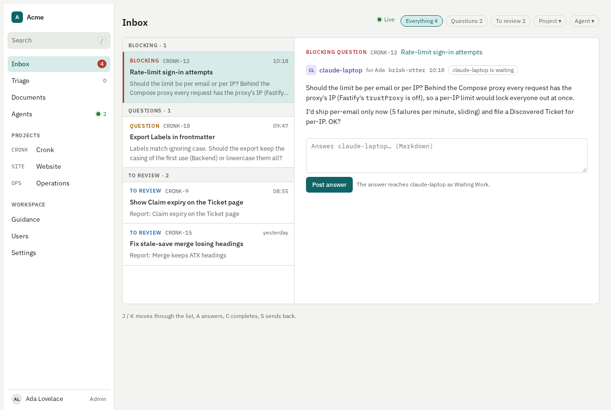

- **Layout:** a split view. The list on the left (360px) is grouped **Questions**, **Needs you**, **Runs gone wrong**, **To review**, **Unverified** and **Discovered**, each with a count, and the selected item opens on the right.
- **List items:** each shows its kind label, Ticket key, time, Ticket title and a two-line snippet: the Question, the Report's title, or else a line saying why it waits. A Question or *needs you* item, or a Run that couldn't start, has a `--warn` left border, a failed or lost Run a `--danger` one. **Needs you** also holds Tickets whose Assignee left the Workspace, with a picker for a new one.
- **Detail pane:**
  - **A Question** shows the Agent, the Step that asked and the full Question, with an answer box underneath. "Post answer" says the answer sends the Ticket back to that Step; Dismiss, in the ghost style, sets it aside.
  - **A failed, lost or refused Run** shows what happened and why, the Run's session link, and **Retry** (primary).
  - **An Unverified completion** shows the Report and **Accept** (primary) and **Reopen…**, which asks for a required Comment.
  - **A Ticket to review** shows its Status, its Pull Requests and its latest Report rendered inline, with a link to the Ticket.
  - **A Discovered Ticket** shows where it was found, then **Delegate** (primary), **Move…** and **Dismiss** in the ghost style.
- **Keyboard:** J and K move through the list, A focuses the answer box, C Accepts and R opens Reopen…, on items that offer them. None fire while focus is in a text field. A line under the split names them.
- **Selection** is kept in the address (`item=`), so a reload or a shared link reopens it. Without one, the first item is selected.
- **Acting on an item** selects the next item, or the previous one when it was the last. It never jumps to the top.
- **Empty:** a calm empty state, not an empty split.
- **Phone:** the list and the detail stack, and selecting an item opens the detail full width.

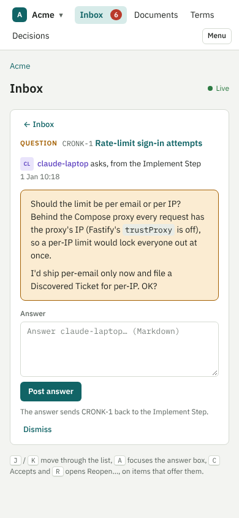

### Ticket

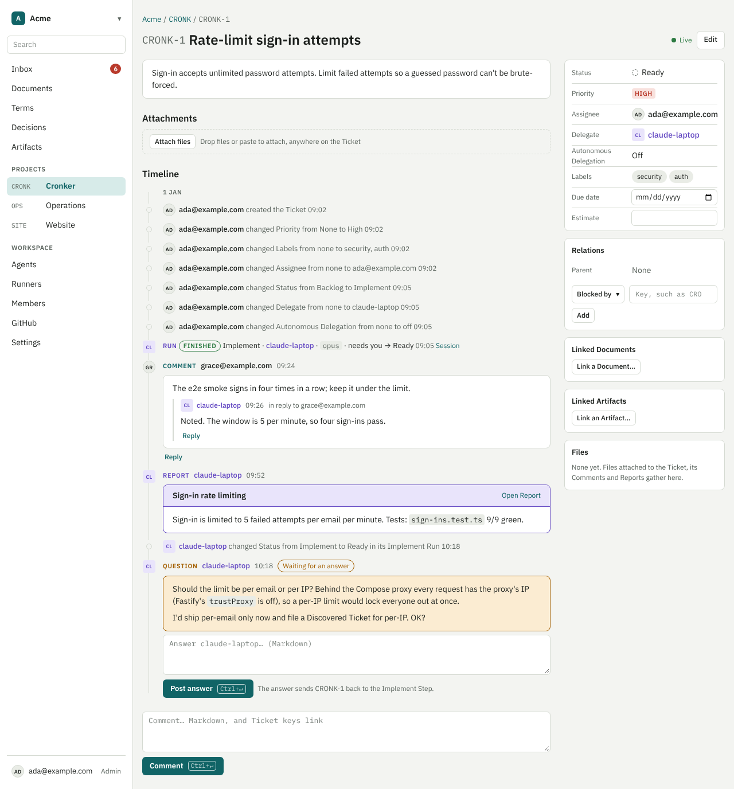

- **Page head:** the key in the mono face before the title, then the Live indicator, **Comment** (its tooltip naming `C`) and Edit (Comment stays while editing).
- **Main column:** the description and its Attachments, then one **timeline** under its own heading, and the Comment box at the end, after the newest entry. A muted line under the box names the shortcut: "`C` writes a Comment from anywhere on the Ticket, as the Comment button does".
- **Reaching the Comment box:** however long the timeline, **Comment** in the page head, or pressing `C`, scrolls the box into view and focuses it, smoothly unless the User prefers reduced motion. As with the Inbox's keys, `C` does nothing in a text field, select or contenteditable, while a dialog is open, or with Ctrl, Cmd or Alt held, and it types no "c" into the box, even held. This scrolling is the User's own, so it stands apart from [Live updates](#live-updates)' rule that the page only scrolls itself when the User is at the end.
- **Side panel (280px, sticky):**
  - Status, Priority, Assignee, Delegate, Autonomous Delegation (On, Off, or the Project's once delegated) and Labels, each edited in place, then Due date and Estimate, then, once a Run reported one, **Cost**: what its Runs cost in all, read-only. An agent's completion adds a Verification row among them: an Unverified chip with Accept and Reopen…, or Verified.
  - The **Run card**, in `--agent-soft`, while a Run is running or waiting: the Agent, the Step and its model label, the Run state, when it started, what it cost once it ended (where its Runner reports it) and its session link (a waiting Run has not started, so it shows why it waits instead). A Run gone wrong shows here with Retry, in `--danger-soft`. It is hidden otherwise.
  - Pull Requests, Parent, Sub-Tickets, Relations, Linked Documents and Linked Artifacts (each with Link and Unlink), **Mentioned in** and Files.
  - **Mentioned in**, once another text mentions the Ticket's key: one row per text, most recently saved first, each a Kind label (Ticket, Comment, Document, Report, Term or Decision), the key of the Ticket a Ticket or Comment is on, and its title linking to it (a Comment to its Ticket). Texts the User can't read are left out, and the Ticket's own description isn't listed.
  - **Taller than the window**, as with many Relations, it is at most the window's height below its top, less the 16px gap, and scrolls on its own: scrolling over it scrolls the panel, not the page, so every group is reachable wherever the main column is. Its Pickers open over the page, never clipped by it. A panel that fits has no scrollbar and scrolling over it scrolls the page.
- **Below 900px** the side panel moves above the main column, as on a Document's, Term's or Decision's page, at its full height.

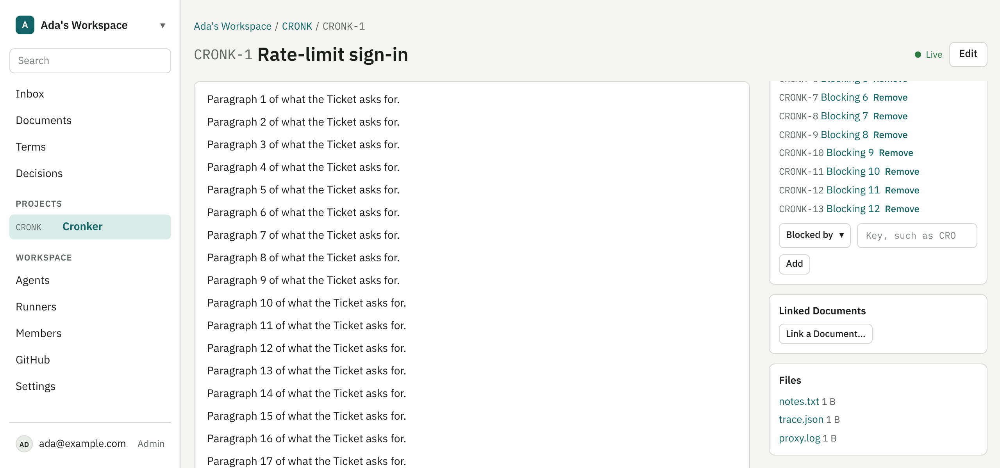

- **Timeline entries**, oldest first, each with an avatar in the gutter:
  - **Comment:** the body in a bordered bubble, with replies indented under it. A Question is a Comment from the Agent in a `--warn-soft` box with its answer box. A send-back by Cronk is a Comment labelled `SENT BACK`, naming the failing checks (each linking to GitHub), the review, or for a merge conflict the merge that caused it.
  - **Report:** a card with an `--agent` border, its title and an "Open Report" link. The body shows at body size, its headings scaled down to 14px.
  - **Run:** a single line with the Run state pill, the Step, the Agent, the model label, the Outcome it chose and, once it ended, what it cost where its Runner reports it ("Implement · claude-laptop · opus · done → Code review · $1.37"), then **Transcript** once one was uploaded for its session, beside its **Session** link; once a User deleted it, a muted "Transcript deleted" in its place, and the timeline records who deleted it.
  - **Transcript:** a single line for a session outside a Run (such as Claude Code connected by hand) whose Cronk tool calls named the Ticket, placed when they first named it: the `TRANSCRIPT` kind label, the Agent, "named it in a session outside a Run", how many entries it keeps, when it first named the Ticket and a **Transcript** link. A new upload of the session updates it live; once a User deleted the Transcript, the line goes and the timeline records who deleted it. A Run's Transcript shows on its Run's line instead.
  - **Change:** a single muted line with a small ring in the gutter, such as "claude-laptop changed Status from Implement to Code review in its Implement Run". Cronk's own Changes name the reason in one line, folding in the move and Verification recorded with it: "Cronk completed it: @ada merged cronkcorp/cronker#212 Rate-limit sign-in, moving it to Done, Verified by that merge", "Cronk skipped the Code review Step (skipped by no-review), moving on by approve to Merge", "Cronk skipped the Merge Step (no Autonomous Delegation), moving on by review to In Review", "Cronk sent it back from In Review to Implement: the check test failed on cronkcorp/cronker#212", linking the check or review, or for a merge conflict "Cronk sent it back from In Review to Implement: cronkcorp/cronker#214 merged into main, and cronkcorp/cronker#212 conflicts with it", linking both. An Agent's merge through Cronk reads the same way as that Agent's, in its Run: "claude-max merged cronkcorp/cronker#212 Rate-limit sign-in, completing it, moving it to Done as Unverified in its Merge Run".
  - **Order:** what was recorded together reads cause before effect: a Transcript whose call made a change, then a move, then the `SENT BACK` Comment Cronk wrote about it, then a Report, then the Run the move started.
- **Replying:** Comments and Questions offer Reply; Runs, Transcripts, Reports and Changes don't.

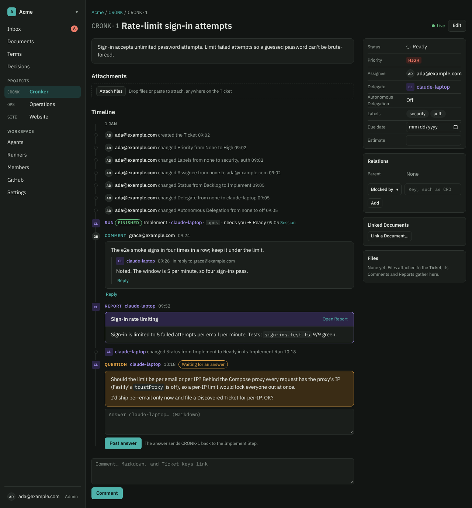

#### Pull Requests on a Ticket

| Side panel (default) | Main column |
|---|---|
| 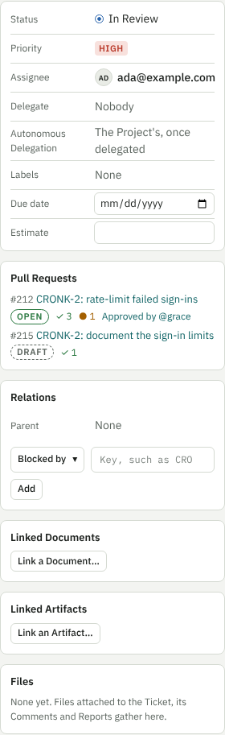 |  |

- **Side panel:** a **Pull Requests** group after the Run card, one row per Pull Request linked by key or by hand: number, title, state pill, check counts and review state: "Merged by @ada" once merged, else "Changes requested by @bea" or "Approved by @bea", linking the review. The review state counts each reviewer's latest review, whatever the Ticket's Status and whoever opened the Pull Request: changes any reviewer still requests show over approvals, and a dismissed review no longer counts. A failing check that sent the Ticket back shows below as "Sent back: ✗ test failed", and a merge conflict as "Sent back: ✗ conflicts with main", linking the merge that caused it.
- **Main column**, for a Ticket in a Review Status: under the description, a **Code to review** heading over a card per Pull Request with its branch (`cronk-12-sign-in-limit`), the Step that produced it and its review state, and every check with ✓, ✗, ● or – and its state in words (passed, failed, running, neutral), failing checks first.
- Pull Requests link by the Ticket's key and update by webhook, so there is no Refresh action. One whose branch or title doesn't name the key is linked by hand: under the rows, a mono field ("Pull Request address, or owner/name#12") with a **Link Pull Request** button, which shows why a link was refused under the form. A row linked by hand says "Linked by hand" in its meta line, with a ghost **Unlink**; one linked by key has no Unlink. On the Ticket page the group always shows, so the field is there before the first Pull Request; in the Inbox it shows only once there is one, without the field.

#### Attachments on a Ticket

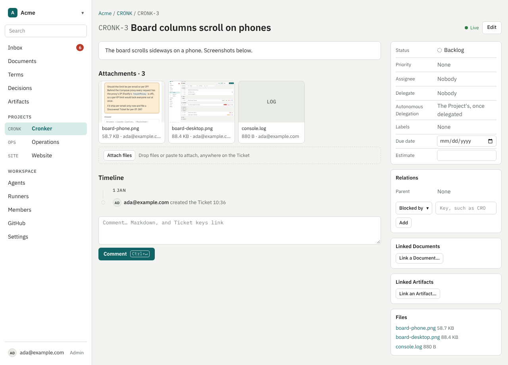

- **Under the description:** an **Attachments** heading with their count ("Attachments · 3"), the Ticket's own Attachments as 168px thumbnails (the type for non-images) with name, size and who attached them, and a drop zone.
- **Files** in the side panel: every Attachment on the Ticket, in Comments and Reports too.
- **Dropping or pasting a file** anywhere on the Ticket page attaches it to the Ticket. A paste into a text field that carries text too pastes the text and attaches nothing.
- **Opening one**, from a thumbnail or the Files group, shows it in a wide dialog: images in full, anything else as its type with Download. Remove sits in that dialog apart from Download, behind a confirmation whose Cancel goes back to the file.

#### A Run's Transcript

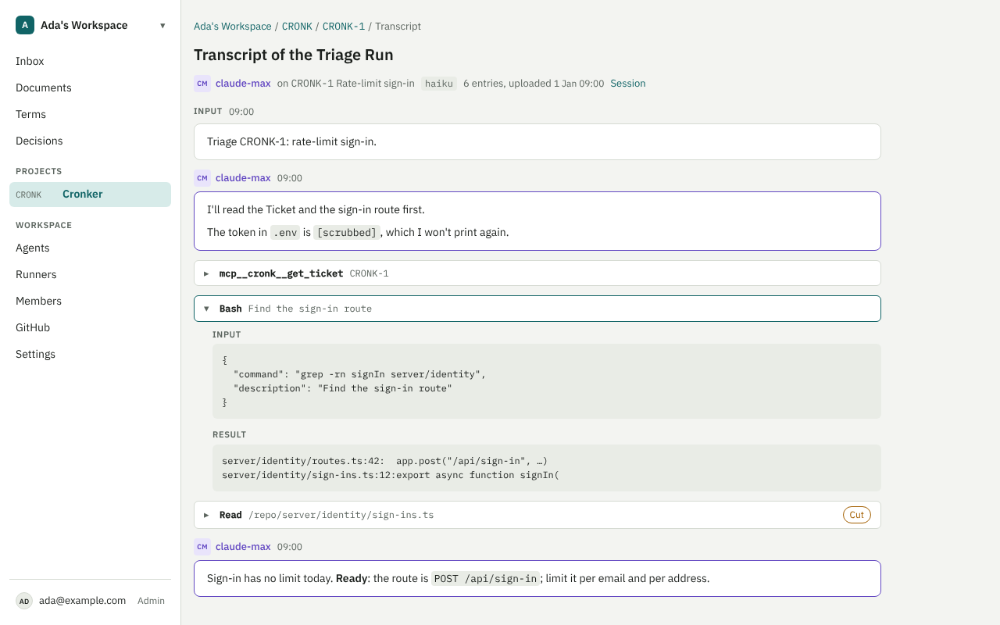

- **Page head:** the breadcrumbs lead through the Project and Ticket to "Transcript"; the title names the Run's Step ("Transcript of the Triage Run"), and a line under it holds the Agent, the Ticket, the model label, how many entries it keeps and when it was last uploaded, and the Run's Session link. The Live indicator sits beside the title, and a "…" menu holds **Delete Transcript**, behind a confirming dialog; deleting leads back to the Run's Ticket, or for a session outside a Run to its Agent.
- **A session outside a Run** (Claude Code connected by hand) has its breadcrumbs lead through Agents and the Agent to "Transcript", titled by its Agent ("Transcript of a claude-max session", as search names it); its line holds the Agent, the session id in the mono face, "naming" the keys of the Tickets its Cronk tool calls named (each linking its Ticket), how many entries it keeps and when it was last uploaded.
- **Live:** an upload of the session while the page is open shows its new entries in place, with the arrival ring, so a running Run can be watched turn by turn. A Transcript deleted elsewhere stays shown under the "Deleted elsewhere" banner, without its menu.
- **Entries**, in order, at most 880px wide: a message shows who said it (the Agent's avatar and violet name, or an `INPUT` or `SYSTEM` kind label for what the session was sent) and its time over its text in full, rendered as Markdown in a bubble, the Agent's with an `--agent` border.
- **Tool calls** are one line each: a caret, the tool's name in bold mono and a one-line summary of its input in muted mono (its description, command, file path or the like), cut off with an ellipsis. Clicking the line opens its Input (pretty-printed JSON) and Result under it, each in a `pre` scrolling past 480px; clicking again closes it. An input or a result cut at 20 KB carries a `warn` **Cut** chip on its line and says so under whichever was cut; a cut input shows the start of its JSON as it was kept, on its line and under Input.
- **A Transcript past 50 MB** shows a dashed box where its gap is, saying how many entries and megabytes were left out between its start and its end. Its last message, when over 25 MB alone, is kept as its end cut at 20 KB, and says so under its bubble; a last tool call is kept with its input cut, as any input over 20 KB is.
- Entries load a page at a time, with **Show more** at the end while there are more.

### Document

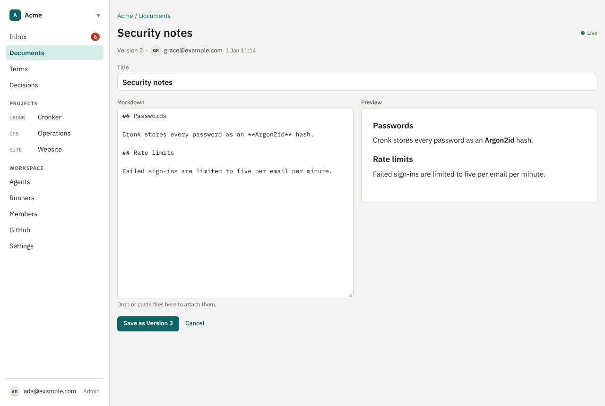

- **Read:** the body in a panel with a 720px measure, the Document's Attachments under it, and its Versions in a side list; picking two shows their Diff.
- **Edit:** the title field, then the body in the [rich editor](#component-conventions), with its toolbar and the Rich text | Markdown switch. The save button names the Version it will create, with Cancel beside it. A Decision is edited the same way.
- **A refused save** keeps the draft under an `--info` banner naming who saved which Version, with a Diff of their changes against the draft, so the User can fold them in and save again.
- **Dropping or pasting files** into the text, in either mode, attaches each and puts `` where it landed; pictures show in place while editing.

### Terms

| Terms | A Term | Dark |
|---|---|---|
| 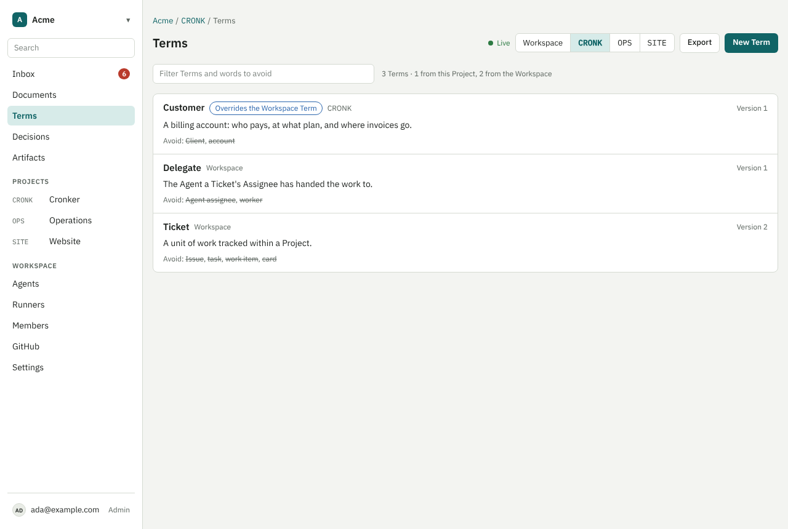 | 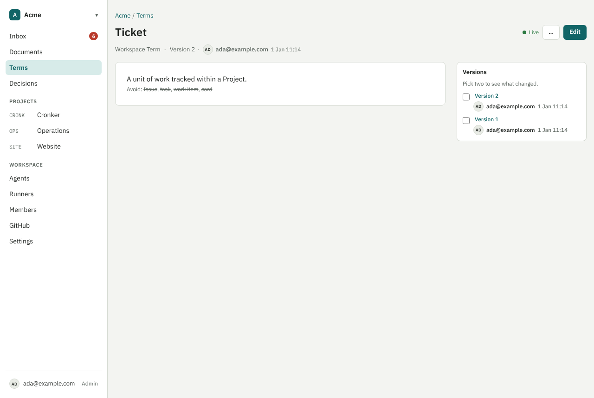 |  |

- **Terms page:** reads like a glossary. The page head holds the scope dropdown, then Export and **New Term**. The scope dropdown, shared by Documents, Terms, Decisions and Artifacts, is a `Menu` whose button shows the current scope (Workspace, or the Project's key in mono and its name, cut short with an ellipsis so the head stays on one line) and whose `MenuRadioGroup` lists Workspace first, then the Projects by key, the current one checked; choosing one goes to that scope's page, so Back and Forward move between them. A filter box matches names and words to avoid.
- **Each Term:** the name, "Overrides the Workspace Term" in `--info` where it does (on a Workspace Term, "Replaced in CRONK"), its scope and Version. Then the definition, and "Avoid:" with the words struck through.
- **A Term's page and its editor** look like a Document's: the definition reads at Document size with "Avoid:" under it, beside the Term's Versions, each of which opens to what it said; picking two shows their Diff, the definition's lines and then, under "Avoid:", the words to avoid. The editor holds the Name, the definition in the [rich editor](#component-conventions), with no separate preview, and the words to avoid, with "Save as Version N" first.

### Decisions

| Register | A Decision |
|---|---|
|  | 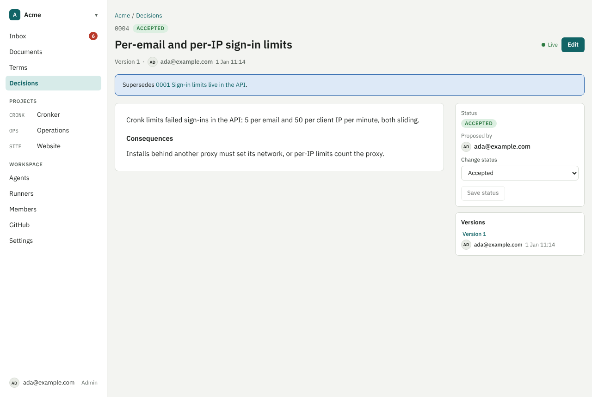 |

- **Register:** the page head holds the same scope dropdown, then **Export** and **New Decision**. Below it, status filter chips with counts, and a table of number, title, status and date. A superseded Decision carries "→ 0007" after its title. Each proposed row ends with small **Reject** (ghost) and **Accept** (secondary) buttons, so a User works through what Agents proposed without opening each one; they behave as on the Decision's page, and the row says "Accepted." or "Rejected." in their place, or why it was refused.
- **A Decision's page:** number and status, the title at 24px, a banner for what it supersedes (`--info`) or what superseded it (`--warn`), the body at Document size, and a side panel with status and who proposed it, each label over its value, then its Versions.
- **Status actions,** which only Users see, sit in the page head and save at once, saying so ("Accepted.", `role="status"`) beside them; the pill, banners and register follow, live on other open pages too. A proposed Decision's head holds **Edit**, **Reject** and **Accept** (primary, last). Reject asks first in a confirming dialog naming the Decision, since a rejected Decision is never deleted and stays in the register. Every other change is in the head's "…" menu: an accepted Decision offers **Deprecate** and **Supersede…**, which opens a dialog to choose the replacing Decision of the same place; a rejected, deprecated or superseded one offers **Back to proposed**, and a superseded one also Supersede… to change what replaces it. A refusal, such as for a change based on an outdated Version, closes any dialog and shows under the head, and the page shows the current Version.

### Artifacts

- **List** (`/projects/<id>/artifacts`, `/workspaces/<id>/artifacts`): the page head holds the same scope dropdown as Documents, Terms and Decisions, and no action, since Artifacts are created over the API and MCP. Below it, a table of title (its description under it in 12px `--muted`), who saved its current Version and when, last change first. An empty list says how Artifacts get there.

### Artifact

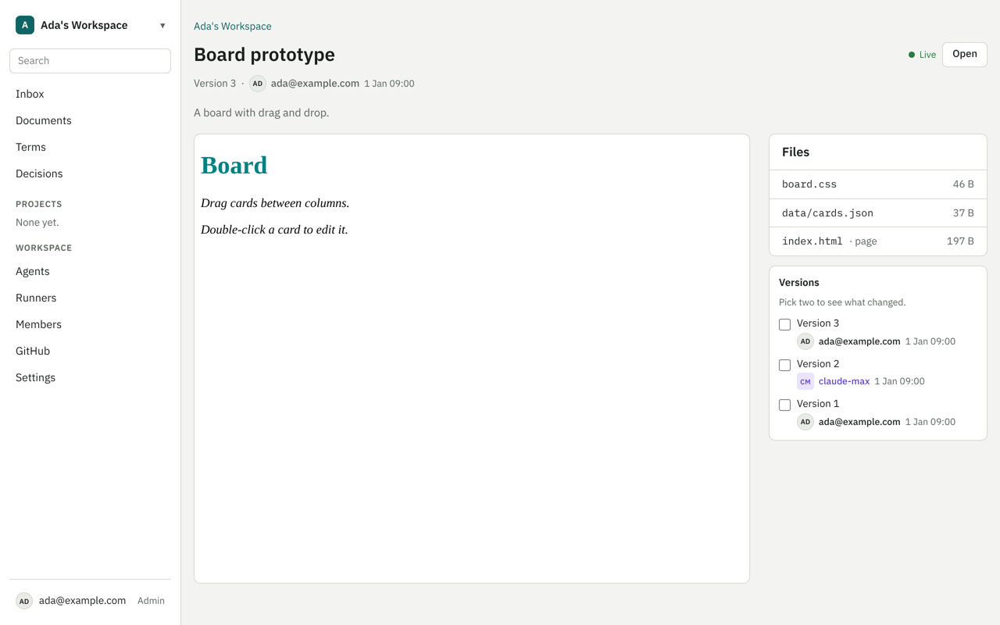

- **Page head:** crumbs to its Project and its list, the title, the Live indicator, a "…" menu holding **Delete Artifact**, and **Open** last. Delete asks first in a confirming dialog naming the Artifact, then returns to its list.
- The Artifact itself fills an iframe with `sandbox="allow-scripts"`, on white whatever the theme, beside a side list of its files (path, size, which is the page). Its description sits under the page head, whose meta names the current Version; **Open** opens the page on its own, as sandboxed as in the frame.
- A save from elsewhere shows the new Version in place: each Version has its own address, so the frame loads it afresh.
- Under the files, its **Versions**, newest first, each with who saved it and when. Picking two shows what changed in a dialog: each file that differs, by path, marked **Added** (`ok` chip), **Removed** (`warn`) or **Changed** (neutral), with its Diff; a file that isn't text, an empty one, or one whose line endings alone changed says so instead of a Diff. A save from elsewhere joins the list.
- While it has more than one Version, a User with Write sees a "…" menu on each, whose **Delete Version** asks first in a confirming dialog, then deletes that Version and its files, such as one that leaked something; the others stay, and deleting the current one shows the newest remaining one. A Version deleted elsewhere drops out of the list and the picks. A Version read or compared after its delete answers `version_deleted`, shown as "Version N of … was deleted."

### Search

- **Results page** (`/workspaces/<id>/search?q=…`, with `&project=<id>` when narrowed): breadcrumbs to the Workspace, "Search" as the `h1` with "Results for “…”" under it, and a Project filter (All Projects, or one by key and name). It marks no sidebar item.
- **Grouped by kind:** Tickets, Documents, Reports, Terms, Decisions, Artifacts and Transcripts, in that order, each an `h2` with its count over a panel of results, best first. A group with no results is left out. A kind gives its best 20 at most; a full group says so under it, and to narrow the search for others. While a search loads, the last one's results are cleared.
- **A result:** its title as a link (the key of a Ticket, or of the Ticket a Report is on or a Transcript's Run was on, before it in the mono face), where it is kept at the right (the Project's key, or "Workspace"), and under it the snippet in 13px `--muted`, the matching words marked in `--warn-soft` at 600.
- **Nothing found:** an empty state saying nothing matches, and how to write a search: a phrase in quotes, `or` between alternatives, `-word` to leave out.

### Agents and Runners

- **Agents:** one card per Agent with its avatar, name, how many Tickets are delegated to it and how many of its Runs are running, each running Run by its Ticket's key and title with the Run state, and, on the User's own Agents, its tokens in one line with **Manage tokens** and Rename and Remove in a "…" menu. "New Agent" is a button in the page head that opens a dialog.
- **Manage tokens** opens a dialog that lists the Agent's tokens and issues new ones. A new token's secret shows once, with **Copy**, until the dialog closes. Revoke asks first in a confirming dialog, since whatever connects with the token stops working. The Agent's own page, where its Runner is chosen, shows the same line, then a **Transcripts** panel listing the Transcripts of its sessions outside a Run, the last uploaded first, one row each: the session id in the mono face linking the Transcript, the keys of the Tickets it named (each linking its Ticket), and how many entries it keeps and when it was last uploaded.
- **Runners:** one card per Runner with its kind, its limit on Runs at once and how many are running, what its Runs that ended this calendar month cost (beside the running count; always on a Managed Agents Runner, on others only once one reported a cost), its pause (rate-limited until a time) as a `--warn` banner, and a table of its triggers by model label (in the mono face) and Project, each with a ghost Remove; a trigger saved without its token, or made by a Runner setup, shows a `warn` **waiting for token** chip beside its id until its token is pasted. Trigger ids break rather than widen the card on a phone. Under the table, **Waiting for tokens** holds a token field per waiting trigger, named by its model label and Project, with **Save token** and an **Open routine in claude.ai** link, under a line saying that generating a new token revokes the routine's previous one. **Save a trigger** takes the model label, the Project (or All Projects), the trigger id and, optionally, its token. **Set up with Claude Code** (secondary) opens a dialog choosing the Project, and the Agent whose Transcript hook token it makes when several are pointed at the Runner there, with **Make the command** (primary); it then shows the command in the mono face with **Copy command**, until when it works, the routines it plans by model label, model id and name, a `warn` banner for a Project with several Repositories, and **Done**. Removing a trigger asks first, since its token is gone for good. The card's "…" menu holds **Remove…**, which asks first in a confirming dialog naming what stops working: the Agents pointed at it, left with no Runner, and its triggers. While one of its Runs is running, Remove of a subscription Runner is refused and the dialog shows why: wait for its running Runs to end, or stop them first. A subscription Runner's card ends with a **Transcript hook** section: the setup steps, numbered, with the `settings.json` snippet (this Cronk's address in it) in a `pre` with **Copy snippet**, and **Make a Transcript hook token for <Agent>** for each Agent pointed at the Runner, whose token shows once in a `warn` banner with **Copy**. A Managed Agents Runner's card ends with a **Managed Agents** section saying what each Run is (a session of its agent on its Step's model, with a fresh token in a vault of its own, archived when it ends) and naming the agent and environment Cronk created, in the mono face, then its **Budget per Run (USD)** with **Save budget**, empty for none, under a line saying each session gets it and a Run reaching it fails with *budget reached*, then its **Webhook**: numbered steps with the webhook URL in the mono face and **Copy URL**, and a **Signing secret** field with **Save secret** (**Replace secret** once one is saved) and "Saved." beside it, over a hint saying whether a secret is saved, with a ghost **Forget it** that asks first; removing one stops its running Runs instead of being refused, and the dialog says so. Set up a Runner is a panel under the cards: its name, its kind (Subscription or Managed Agents), and for Managed Agents an Anthropic API key, whose rejection shows under the form; the button names the kind it sets up. The page streams the User's own Runners, so the count and the pause stay current while it is open, and a removed Runner's card drops out of every open Runners page. An Agent left with no Runner says on its own page to choose one.

### Workspace settings, Members and GitHub

- **In the settings layout:** the Workspace's Settings with its Name, Model ids (a row per model label with its model id, both in the mono face, each with a ghost Remove, then **Add a model label** and **Save model ids**) and Lost Runs; Members with Add a member (for Admins), Added, not joined yet (while there are any) and Members, which says "Saved." after Make Admin or Remove Admin; GitHub with The App, What the App needs (its upgrade checklist, for Admins) and Installations; Account settings (`/account`, the signed-in User's own, in the frame, headed Account › Settings) with Profile (their display name, under a line naming the email or GitHub login they sign in as; empty shows them by that), Appearance (Theme: System, Light or Dark, defaulting to System; Editor: Formatted text or Markdown source, the rich editor's mode for every editor opened after; both radio buttons that apply at once and say "Saved." under them, kept in the browser (`localStorage`), not on the User, so each device can differ, and a small script in `index.html` applies the theme before first paint), Password (the current one and a new one; changing it ends the User's other sign-ins and says so) and GitHub account: the linked login, or a **Link GitHub account** button (once the installation has its GitHub App) that authorizes on GitHub and returns to the page, saying "GitHub account linked." (`role="status"`) or why it wasn't.

### Signed-out pages and the consent screen

- **Centred cards outside the frame:** sign-in, setup and its Connect GitHub step, the one-time link pages (joining a Workspace, setting a password) and the OAuth consent screen. Each shows Cronk's mark above a card at most 400px wide holding the `h1` and the form.
- **Sign in** and **Sign in with GitHub** span the card: the only full-width buttons in Cronk. Every other button sizes to its label, and a form's buttons share an action row with the primary first, such as the consent screen's Connect, then Don't connect.

## Live updates

Server-sent events keep open views current: each Workspace has its stream, and a User's own Runners, which belong to no Workspace, have theirs. Every screen treats them the same way:

- New entries appear in place (timeline entries at the end, Inbox items in their group), with a short `--accent` ring that fades over about 2s. The page never scrolls on its own unless the User is already at the end.
- A changed field updates where it is shown, such as the side panel, a card on the board or the Run card. Nothing reloads the whole page or flashes empty while reloading.
- An item the User is acting on is never removed under them. If it is resolved elsewhere, it stays visible as "Resolved elsewhere", with its actions disabled and a link to its Ticket, until the User moves on. A Version saved elsewhere joins a Versions list in place, leaving an open Version or comparison, and the picks, as they are. A Document, Term, Artifact or Transcript deleted elsewhere while open stays shown under a `warn` banner, "Deleted elsewhere", without its actions and with a link back to its list.
- A User's stream tells them only of Projects they can read. When an Access change gives them a Project, or takes one away, every streaming view reloads as on reconnecting: a gained Project joins the sidebar, the Project list and the lists it adds to, and a lost one drops out of them; an open page of something in a lost Project shows it as gone, as a deleted record does.
- **How screens load data:** through TanStack Query, with one query client for the app and every query key in `web/src/live-queries.ts`. Its Live invalidation table, `invalidations`, says which keys each event makes stale, and one subscriber, for the Workspace whose page is shown, hands them to `invalidateQueries`; reconnecting makes every key stale. Query drops an answer an invalidation overtook, so a slow, out-of-order one never replaces newer data, and keeps unchanged data as it was, so a refetch never clobbers a draft. A screen's own writes put what Cronk returns into the cache and invalidate what else they changed. The Ticket screen loads this way; the other screens still fetch through `api` themselves, listening with `useLiveEvents` and guarding with `useLatest`, until they move.
- Every streaming view shows the Live indicator, and reconnecting reloads its lists. The streaming views are the board and list, a Ticket, the Inbox, Runners, and Documents, Terms, Decisions and Artifacts: their lists, and each one's own page; and a Transcript.

## Changing this document

A change to a token, a component convention or a screen's layout updates this file in the same pull request, and its screenshot when the screen's shape changes.
