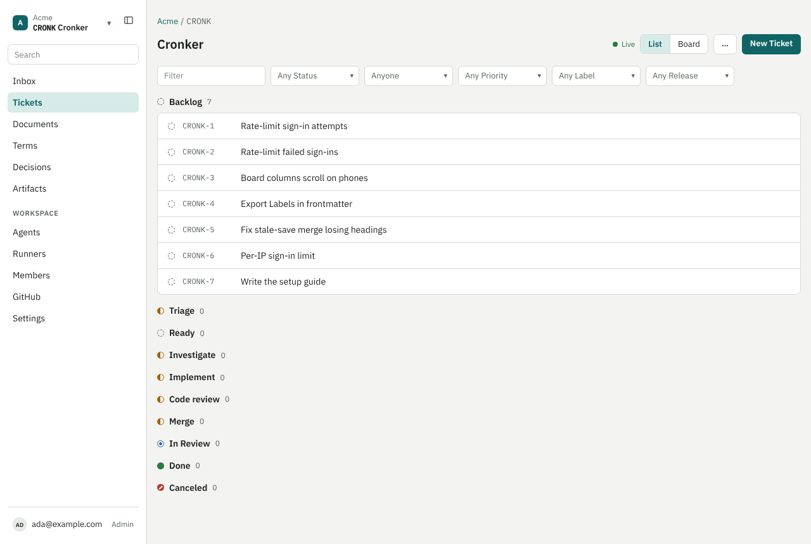
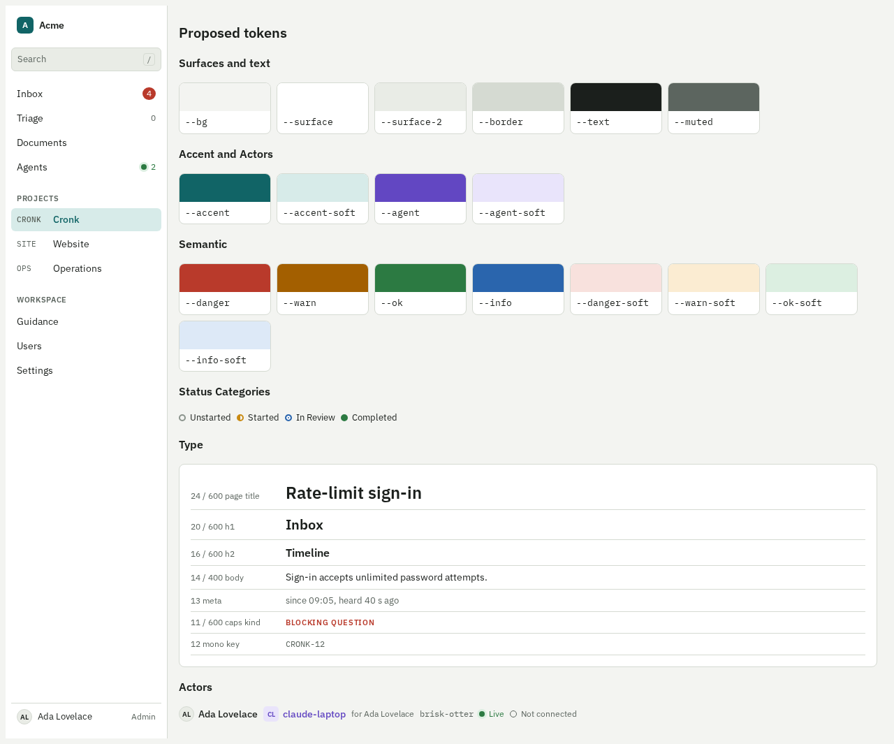
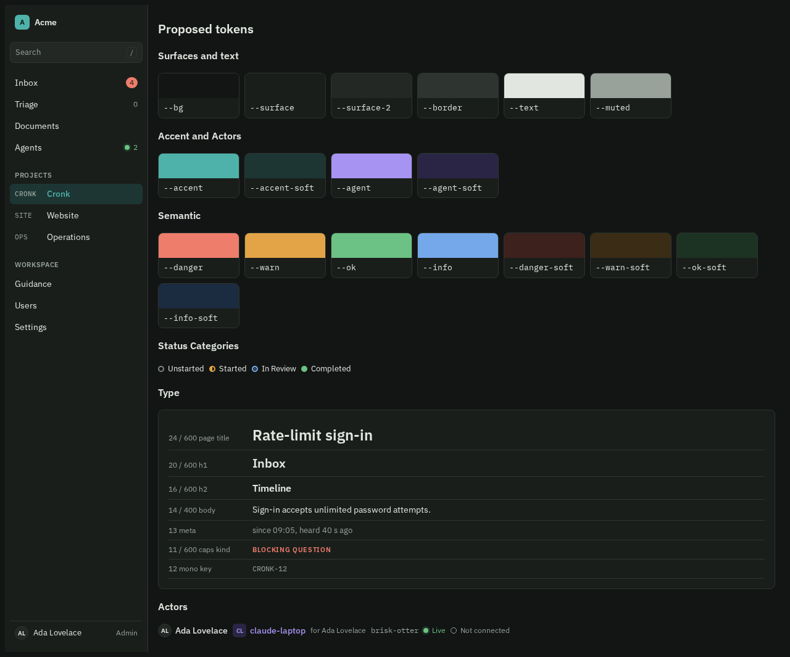
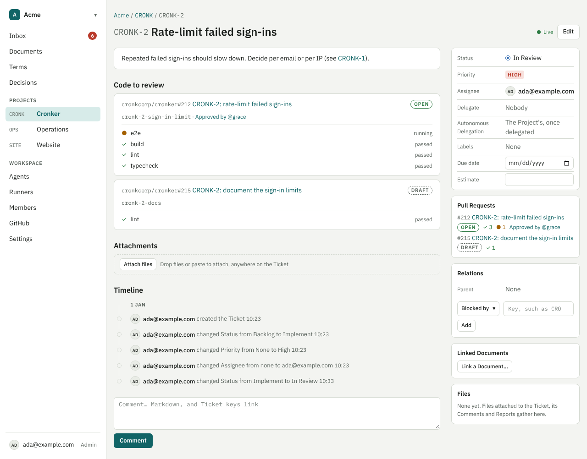
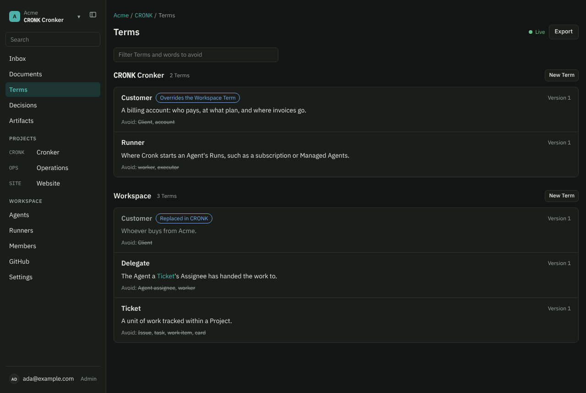
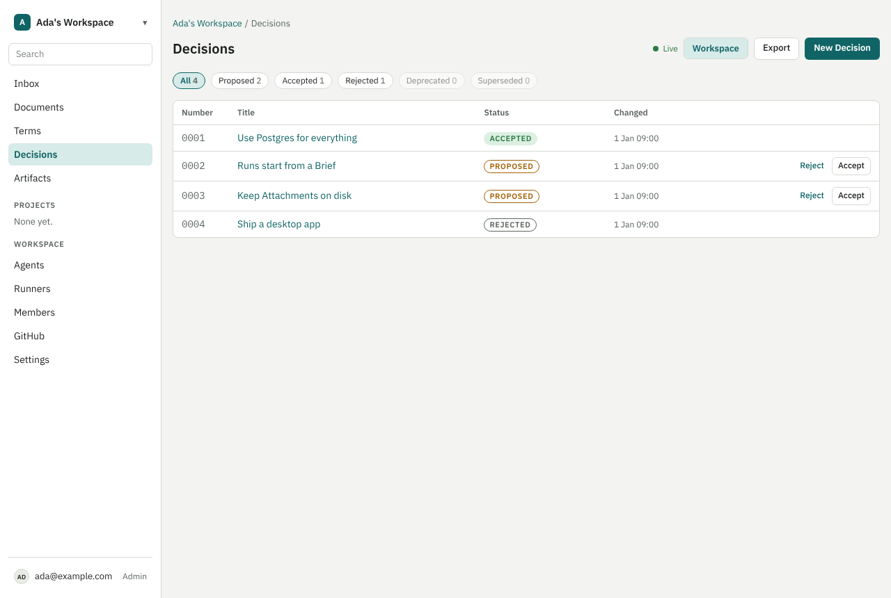

# UI

How Cronk's web client looks and behaves. Read this before changing anything in the web client. Vocabulary follows `CONTEXT.md`. The UI holds no rules (`docs/testing.md`), so everything here is about presentation.

This direction comes from the old Cronk (`CronkCorp/Cronk`, its `docs/ui.md`), adapted to this rewrite. The screenshots in `docs/ui/` are the old Cronk's prototypes: they show the look to aim for, but also concepts this rewrite dropped (Claims, Agent Sessions, Protected items, Suggestions, Triage). Where a screenshot and this text differ, the text wins.

The web client follows this file since the styling pass at the end of milestone 2 (`docs/roadmap.md`). The tokens live in `web/src/styles/tokens.css`, the shared components in `web/src/ui/`, the frame in `web/src/frame.tsx`, and each screen's layout in `web/src/styles/screens.css`. New screens build on them.

## Principles

- **What waits on the User comes first.** Questions before reviews, unread before read. Counts in the navigation say how much is waiting.
- **Agents and Users always look different.** A User's avatar is round and neutral. An Agent's is square and violet (`--agent`), and its name is violet wherever it appears. Cronk itself is plain muted text with a neutral round "C" avatar.
- **One chronology per thing.** A Ticket has one timeline holding its Comments, Reports, Runs and Changes. There is no separate history list.
- **Kinds are labelled, not just coloured.** Every timeline entry and Inbox item carries a small uppercase kind label (`QUESTION`, `REPORT`, `UNVERIFIED`). Colour backs the label up and never replaces it.
- **Live, in place.** Open views update without a reload and without moving what the User is reading (see [Live updates](#live-updates)).
- **Product words only.** Labels use `CONTEXT.md` terms ("Delegate", "Retry", "Accept", "Reopen"), never API words ("PATCH", "statusId").

## Layout and navigation

- **Frame:** a 232px left sidebar and a main column. The main column's content is at most 1120px wide, centred, with 24px vertical and 16px horizontal padding.
- **Sidebar, top to bottom:**
  - The Workspace name and mark, which switches Workspace.
  - Inbox, with the number of waiting items as a red count.
  - Documents, Terms and Decisions (the Workspace's, or the current Project's).
  - **Projects**, each listed by key and name.
  - **Workspace**: Agents and Runners, plus Members, GitHub and Settings for Admins.
  - The signed-in User, which opens a menu: Password and Sign out.
- **Active item:** `--accent-soft` background with `--accent` text. There is exactly one active item; a Ticket or Document marks its Project or Documents.
- **Below 760px** the sidebar becomes a wrapping strip with the main links, and Projects, Workspace and the User move into a menu. Two-pane screens stack.
- **Page head:** breadcrumbs (13px, muted), then a row holding the `h1`, the view switcher and the actions. The primary action comes last. Destructive actions such as Remove go in a "…" menu, never next to the primary action.
- **Routes stay as they are.** The styling pass changes how screens look, not their addresses. The one page it added is the Workspace's Settings (`/workspaces/<id>/settings`: its name and lost-Run threshold, which used to sit on Members), so the sidebar's Settings has a page of its own.
- **A Ticket's or Document's Project:** a page tells the frame which item it belongs to and which Project it is in (`usePlace`), and the sidebar's Documents, Terms and Decisions then lead to that Project's.

## Design tokens

All colours are CSS custom properties on `:root` in the web client's stylesheet. Components use only tokens, never literal colours. The dark values apply under `prefers-color-scheme: dark`.

| Token | Light | Dark | Use |
|---|---|---|---|
| `--bg` | `#f3f4f1` | `#121513` | Page ground |
| `--surface` | `#ffffff` | `#1a1e1b` | Panels, rows, cards |
| `--surface-2` | `#e9ece6` | `#232825` | Sunken: inputs, code, chips |
| `--border` | `#d5dad2` | `#2e3430` | All borders and dividers |
| `--text` | `#1b1f1c` | `#e2e6e1` | Body text |
| `--muted` | `#5c655f` | `#98a29b` | Meta, labels, timestamps |
| `--accent` | `#116466` | `#4fb2aa` | Links, primary buttons, focus ring, active nav |
| `--accent-soft` | `#d7ebe9` | `#1d3634` | Active and selected backgrounds |
| `--on-accent` | `#ffffff` | `#0c1514` | Text on `--accent` and `--danger` |
| `--agent` | `#6247c2` | `#a793f2` | Agent names, avatars, Reports, running Runs |
| `--agent-soft` | `#e9e4fb` | `#2b2545` | Agent avatar and Run card backgrounds |
| `--danger` / `-soft` | `#b93a2b` / `#f8e1dd` | `#ee7d6b` / `#3d211d` | Failed and lost Runs, errors, Urgent, destructive actions |
| `--warn` / `-soft` | `#a35f00` / `#fbecd2` | `#e3a447` / `#3a2c15` | Questions, *needs you*, outdated-save warnings |
| `--ok` / `-soft` | `#2c7a42` / `#dcefe1` | `#6cc284` / `#1c3324` | Live, finished Runs, Done, Verified, added diff lines |
| `--info` / `-soft` | `#2a65ad` / `#dde9f7` | `#74a8ea` / `#1b2b40` | Review Statuses, Unverified, information banners |

**Status kinds** use their own dot colours: Backlog a dashed muted ring, Active a half-filled `--warn` dot, Review a ringed `--info` dot, Done a filled `--ok` dot, and Canceled a `--danger` dot with a stroke. A Status shows its dot and its name. Dense rows and board columns may show the dot alone, with the name in its tooltip and accessible label. A Status with a Step adds the Step's model label in the mono face (`opus`).

| Tokens | Values |
|---|---|
| Spacing | 4, 8, 12, 16, 24, 32 px. Lay groups out with `gap`, not margins. |
| Radius | 4px for controls and chips inside text, 6px for buttons and inputs, 8px for panels and cards, 999px for pills |
| Borders | 1px `--border`. A coloured 3px left border marks a selected list item, or one that needs the User, only. |
| Shadow | Popovers and menus only (`--shadow`) |
| Scrim | `--scrim` dims the page behind a dialog: `rgb(27 31 28 / 0.35)` light, `rgb(0 0 0 / 0.55)` dark |

| Light | Dark |
|---|---|
|  |  |

## Typography

- **Faces:** IBM Plex Sans for UI and prose, and IBM Plex Mono for Ticket keys, Run ids, model labels, code and Markdown sources. They are bundled from npm (`@fontsource/ibm-plex-sans`, `@fontsource/ibm-plex-mono`) and served by Cronk itself. Never load fonts from a CDN, since installations may be offline. The fallbacks are `system-ui` and `ui-monospace`.
- **Scale:** 24/600 (Ticket and Document titles), 20/600 (`h1`), 16/600 (`h2`), 14/600 (`h3`), 14/400 (body), 13 (meta and controls), 12 (small meta, chips, keys), and 11/600 uppercase with 0.06em letter-spacing (kind labels and nav group labels).
- **Line height:** 1.5 for UI and 1.65 for Document bodies. Document text is 15px with a 720px measure.

## Component conventions

The web client keeps its own small component set, styled with the tokens in plain CSS. Accessibility-heavy primitives come from Radix UI's headless packages (popover, dropdown menu, dialog), each wrapped once (`Popover`, `Menu` with `MenuItem` and `MenuLink`, `Dialog` and `ConfirmDialog`) and styled by our classes. Every view switch so far is an address (List / Board, the scope switch), so no screen needs tabs yet; Radix's tabs join the set, wrapped once as `Tabs`, when one does. Cronk uses no styled component library and no Tailwind. A new component joins the set before a second screen copies it.

- **Actor** (`<Actor>`): avatar plus name. An avatar's letters are drawn by CSS, so they stay out of the text around them. A User is round. An Agent is square and violet, followed by "for <Owner>" where the Owner isn't obvious. Cronk is muted text with its "C" avatar.
- **Key** (`<Key>`) and **model label** (`<ModelLabel>`): a Ticket or Project key, or a model label, in the mono face; a key at 12px `--muted`.
- **Status** (`<StatusPill>`): dot and name. **Priority** (`<PriorityTag>`): a small uppercase tag. Urgent is filled `--danger`, High is `--danger` on `--danger-soft`, Medium is `--warn` on `--warn-soft`, Low is muted, and None shows nothing.
- **Label** (`<Chip>`): a neutral chip on `--surface-2`. A state marker takes a tone: `ok` ("Verified", "Answered") is filled `--ok-soft`; `warn` ("Waiting for an answer") and `danger` ("Failed") are outlined pills in that colour; `info` ("Unverified", "Overrides the Workspace Term") is the same outlined pill; `agent` marks what Agents did.
- **Run state** (`<RunState>`): 11px uppercase pill. Running is `--agent` on `--agent-soft` with a pulsing dot, Finished outlined `--ok`, Failed and Lost outlined `--danger`, Stopped outlined `--muted`, Refused (*couldn't start*) outlined `--warn`, and Waiting (Runner full, rate-limited, or blocked by another Ticket) dashed `--muted` with the reason in its tooltip. Each pill also reads out "Run" and its reason, so it makes sense on its own.
- **Banner** (`<Banner tone>`): a full-width box above an editor or detail. `info` (`--info-soft` with an `--info` border) says what to settle, such as a refused save. `warn` (`--warn-soft` with a `--warn` border) says what to heed, such as a Version saved meanwhile.
- **Kind label** (`<KindLabel>`): 11px uppercase, coloured by kind. Comment `--accent`; Question and Needs you `--warn`; Failed, Lost and Error `--danger`; Report, Run and Decision `--agent`; To review and Unverified `--info`; Discovered `--warn`; Sent back (by Cronk) `--warn`.
- **Buttons** (`<Button variant>`, or `buttonClass` for a link or file picker that looks like one):
  - Primary is filled `--accent`, one per form or action bar. It comes first in forms and action bars, and last in the page head and in dialogs. A dialog's action row is right-aligned: the dismissing button, such as Cancel, first and the primary or danger button last.
  - Secondary is `--surface` with a border.
  - Ghost is text in `--accent`, for Reply, Rename and the like.
  - Danger is filled `--danger`, and only inside a confirming dialog.
  - A disabled button keeps its colours at 50% opacity with a `not-allowed` cursor.
  - Buttons size to their label and are never full width outside sign-in forms.
- **Forms:** the label sits above the field, in 12px `--muted`. Inputs have a `--surface` background and a 1px border, and show the `--accent` focus ring. Markdown inputs use the mono face. Each error sits under its form in `--danger` with `role="alert"`, and a refusal's rule and advice show as Cronk gives them. A settings page stays open after saving and says "Saved." beside its buttons (`role="status"`).
- **Pickers** (`<FieldPicker>`): Ticket fields are edited in place. Clicking the value opens a popover list with type-to-filter; once something is typed, Enter picks the first match, and a picker that takes new values (Labels) offers the typed text. Bare `<select>` rows are not used for this.
- **Times** (`<RelativeTime>`):
  - Relative under an hour ("12 min ago").
  - Then clock time for today ("10:18") and "yesterday".
  - Then day and time ("14 Nov 09:52"), with the year only when it differs from the current one.
  - The exact time is always in `title`.
  - A timeline shows clock times with a separator for each day ("Today", "Yesterday", "14 Nov").
- **Empty states:** a short heading saying what will appear and one line saying how it gets there ("Runs write a Report when they finish a Step").
- **Decision status** (`<DecisionStatusPill>`): 11px uppercase pill. Proposed is outlined `--warn`, Accepted filled `--ok-soft` with `--ok` text, Superseded outlined `--info`, Rejected outlined `--muted`, and Deprecated dashed `--muted`.
- **Pull Request state** (`<PullRequestState>`): 11px uppercase pill. Draft dashed `--muted`, Open outlined `--ok`, Merged filled `--agent-soft` with `--agent` text, Closed outlined `--danger`. **Checks** show as counts: ✓ in `--ok`, ✗ in `--danger`, ● running in `--warn`.
- **Diff** (`<Diff>`): mono lines on `--surface`, removed lines on `--danger-soft` and struck through, added on `--ok-soft`, with a header naming the two Versions.
- **Live indicator** (`<LiveIndicator>`): a green dot with "Live" on views that are streaming. It turns into a muted "Reconnecting…" while the stream is away.

## Screens

### Project

- **Page head:** the title, a List / Board segmented control, a "…" menu (Documents, Terms, Decisions, Project settings), and New Ticket as the only primary action, last.
- **Project settings:** one section each for Statuses and their Steps, Delegation defaults (new Tickets delegated, Autonomous Delegation), Repositories and Pull Request automation.
- **List rows:** Status dot, key, title, Labels, Priority tag, the running Run's state when there is one, and the Delegate's and Assignee's avatars, each named in its tooltip ("Delegate: claude-laptop").
- **Board:** open columns share the main column's width. Done and Canceled columns start collapsed to their dot and count; clicking one opens it until the User leaves the page, and nothing is stored. A 1280px screen shows every Status without sideways scrolling. Cards show the key, Priority, title, Labels, the avatars, and a Run state pill while a Run is running, waiting or has gone wrong.

### Inbox

- **Layout:** a split view. The list on the left (360px) is grouped **Questions**, **Needs you**, **Runs gone wrong**, **To review**, **Unverified** and **Discovered**, each with a count, and the selected item opens on the right.
- **List items:** each shows its kind label, Ticket key, time, Ticket title and a two-line snippet of the Question, or the Report's title. An item needing an answer has a `--warn` left border, a failed or lost Run a `--danger` one.
- **Detail pane:**
  - **A Question** shows the Agent, the Step that asked and the full Question, with an answer box underneath. "Post answer" says the answer sends the Ticket back to that Step.
  - **A failed, lost or refused Run** shows what happened and why, the Run's session link, and **Retry** (primary).
  - **An Unverified completion** shows the Report and **Accept** (primary) and **Reopen…**, which asks for a required Comment.
  - **A Ticket to review** shows its Status, its Pull Requests and its latest Report rendered inline, with a link to the Ticket.
  - **A Discovered Ticket** shows where it was found, then **Delegate** (primary), **Move…** and **Dismiss** in the ghost style.
- **Keyboard:** J and K move through the list, A focuses the answer box, C Accepts and R opens Reopen…, on items that offer them. None fire while focus is in a text field. A line under the split names them.
- **Selection** is kept in the address (`item=`), so a reload or a shared link reopens it. Without one, the first item is selected.
- **Acting on an item** selects the next item, or the previous one when it was the last. It never jumps to the top.
- **Empty:** a calm empty state, not an empty split.
- **Phone:** the list and the detail stack, and selecting an item opens the detail full width.

### Ticket

- **Main column:** the title, the description and its Attachments, then one **timeline**, and the Comment box at the end.
- **Side panel (280px, sticky):**
  - Status, Priority, Assignee, Delegate, Autonomous Delegation and Labels, each edited in place. An agent's completion adds a Verification row: an Unverified chip with Accept and Reopen…, or Verified.
  - The **Run card**, in `--agent-soft`, while a Run is running or waiting: the Agent, the Step and its model label, the Run state, when it started and its session link. A Run gone wrong shows here with Retry. It is hidden otherwise.
  - Pull Requests, Parent, Sub-Tickets, Relations, Linked Documents (with Link and Unlink) and Files.
- **Below 900px** the side panel moves above the timeline.
- **Timeline entries**, oldest first, each with an avatar in the gutter:
  - **Comment:** the body in a bordered bubble, with replies indented under it. A Question is a Comment from the Agent in a `--warn-soft` box with its answer box. A send-back by Cronk is a Comment labelled `SENT BACK`, naming the failing checks (each linking to GitHub) or the review.
  - **Report:** a card with an `--agent` border, its title and an "Open Report" link. The body shows at body size, its headings scaled down to 14px.
  - **Run:** a single line with the Run state pill, the Step, the Agent and the Outcome it chose ("Implement · claude-laptop · done → Code review").
  - **Change:** a single muted line with a small ring in the gutter, such as "claude-laptop moved it from Implement to Code review". Cronk's own Changes name the reason ("Cronk moved it to Done: Ada merged #212, Verified by that merge").
- **Replying:** Comments and Questions offer Reply; Runs, Reports and Changes don't.

#### Pull Requests on a Ticket

| Side panel (default) | Main column |
|---|---|
|  |  |

- **Side panel:** a **Pull Requests** group after the Run card, one row per Pull Request: number, title, state pill, check counts and review state ("Changes requested", "Merged by Ada").
- **Main column**, for a Ticket in a Review Status: a card per Pull Request under the description with the branch (`cronk-12-sign-in-limit → main`), its author and review state, and every check with ✓, ✗ or ●.
- The screenshots show a Refresh button and a Link a Pull Request… action from the old Cronk; this rewrite links by key only and updates by webhook, so neither exists.

#### Attachments on a Ticket

- **Under the description:** the Ticket's own Attachments as 168px thumbnails (the type for non-images) with name, size and who attached them, and a drop zone.
- **Files** in the side panel: every Attachment on the Ticket, in Comments and Reports too.
- **Dropping or pasting a file** anywhere on the Ticket page attaches it to the Ticket. A paste into a text field that carries text too pastes the text and attaches nothing.
- **Opening one** shows it in a wide dialog: images in full, anything else as its type with Download. Remove sits in that dialog behind a confirmation.

### Document

- **Read:** the body in a panel with a 720px measure, the Document's Attachments under it, and its Versions in a side list; picking two shows their Diff.
- **Edit:** the title field, then the Markdown source (mono) beside a live preview rendered by the same pipeline as the read view; they stack on phones. The save button names the Version it will create. The screenshot's toolbar comes with the rich editor, later.
- **A refused save** keeps the draft under an `--info` banner naming who saved which Version, with a Diff of their changes against the draft, so the User can fold them in and save again.
- **Dropping or pasting files** into the source attaches each and puts `` at the cursor.

### Terms

| Terms | A Term | Dark |
|---|---|---|
|  |  |  |

- **Terms page:** reads like a glossary. The page head holds a Workspace / Project scope switch, then Export and **New Term**. A filter box matches names and words to avoid.
- **Each Term:** the name, "Overrides the Workspace Term" in `--info` where it does (on a Workspace Term, "Replaced in CRONK"), its scope and Version. Then the definition, and "Avoid:" with the words struck through.
- The screenshots' groups, Protected marks and Suggestion counts belong to the old Cronk.

### Decisions

- **Register:** the page head holds the same scope switch, then **Export** and **New Decision**. Below it, status filter chips with counts, and a table of number, title, status and date. A superseded Decision carries "→ 0007" after its title.
- **A Decision's page:** number and status, the title at 24px, a banner for what it supersedes (`--info`) or what superseded it (`--warn`), the body at Document size, and a side panel with status and who proposed it. Only Users see the status actions.

### Agents and Runners

- **Agents:** one card per Agent with its avatar, name, the Tickets delegated to it and its running Runs, its tokens in one line with **Manage tokens**, and Rename and Remove in a "…" menu. "New Agent" is a button in the page head that opens a dialog.
- **Runners:** one card per Runner with its kind, its limit on Runs at once and how many are running, its pause (rate-limited until a time) as a `--warn` banner, and its triggers per model label in the mono face.

### Signed-out pages, the password page and the consent screen

- **Centred cards outside the frame:** sign-in, setup and its Connect GitHub step, the one-time link pages (joining a Workspace, setting a password), the password page and the OAuth consent screen. Each shows Cronk's mark above a card at most 400px wide holding the `h1` and the form.
- **Sign in** and **Sign in with GitHub** span the card: the only full-width buttons in Cronk. Every other button sizes to its label, and a form's buttons share an action row with the primary first, such as the consent screen's Connect, then Don't connect.
- **The password page** leads back to the Workspace on screen with "Back to Cronk".

## Live updates

Server-sent events keep open views current. Every screen treats them the same way:

- New entries appear in place (timeline entries at the end, Inbox items in their group), with a short `--accent` ring that fades over about 2s. The page never scrolls on its own unless the User is already at the end.
- A changed field updates where it is shown, such as the side panel, a card on the board or the Run card. Nothing reloads the whole page or flashes empty while reloading.
- An item the User is acting on is never removed under them. If it is resolved elsewhere, it stays visible as "Resolved elsewhere", with its actions disabled and a link to its Ticket, until the User moves on.
- Every streaming view shows the Live indicator, and reconnecting reloads its lists.

## Changing this document

A change to a token, a component convention or a screen's layout updates this file in the same pull request, and its screenshot when the screen's shape changes.
